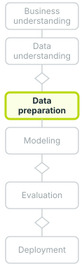
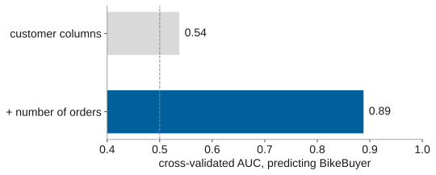

# Parked: the Zalaxus leak

Slide 9 of the 15 October draft of this deck, taken out on Oscar's review of 15 October 2026:
it did not fit the deck's arc, which now shows the optimism of cross-validation through rows
that come in groups (slides 10 to 12). Kept here, source and notes, to be placed again later;
its figure stays in `images/zalaxus-leak.svg`, drawn by `tools/figures.py --zalaxus`.

To restore it, paste the block below between two `---` separators of `index.html`.

```markdown
# One column took Zalaxus from chance to 0.89



.beside-thumb[


.large.center[`BikeBuyer` is computed from the orders: a customer with a bike among them. Counting the orders hands the answer to the model.]
]

.footnote[Zalaxus, the module's group-project dataset; a random forest, scikit-learn. .book[<i class="fa-solid fa-book-open"></i> Provost & Fawcett (2013), p. 30.]]

???

Zalaxus is the module's teaching dataset, a fictitious retailer whose customers are classified as bike buyers or not. The target, `BikeBuyer`, is derived from the orders table: a customer is a buyer exactly when at least one order line is a bike. With the customer columns alone (age, income, education), a random forest reaches a cross-validated AUC of 0.537, barely above chance. Adding the number of orders lifts it to 0.888: the count carries the answer because customers with more orders are more likely to have a bike among them. The number of orders would not be known for the targeting question, which concerns customers who have not yet bought. Provost and Fawcett warn that "leakage must be considered carefully during data preparation" (Provost & Fawcett, 2013, p. 30, verbatim), because data preparation works on historical records where such variables sit alongside the target. Zalaxus is the dataset students use for the group project; the next slide lists the kinds of leaks to check before trusting any score.
```
